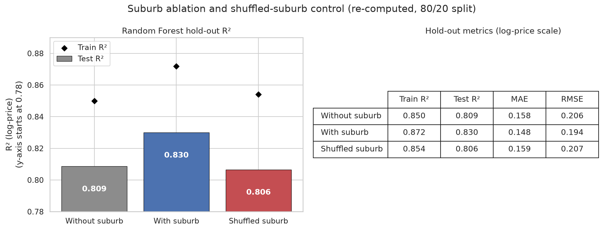
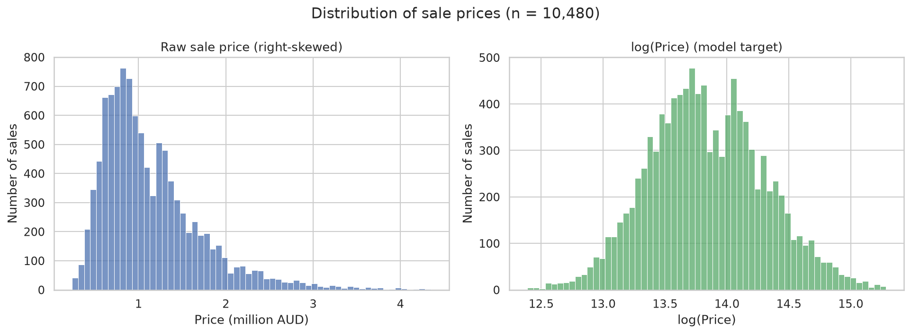
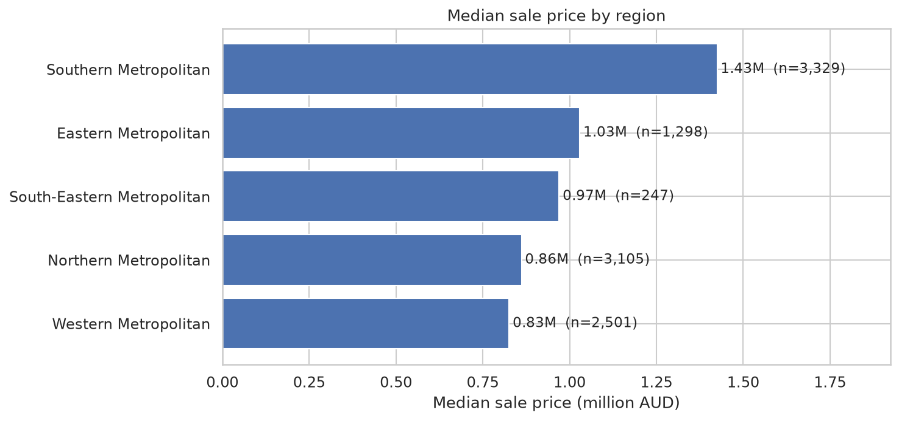
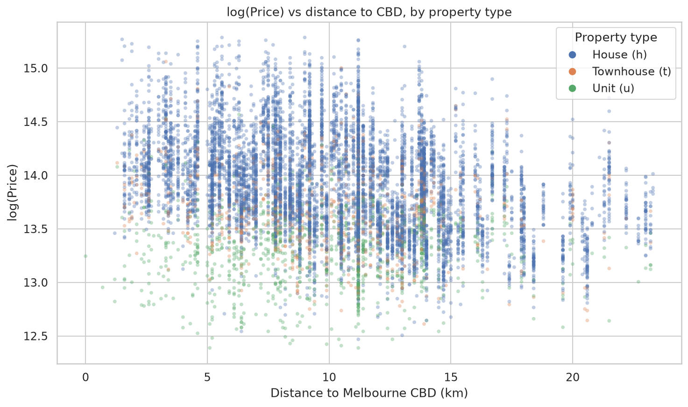
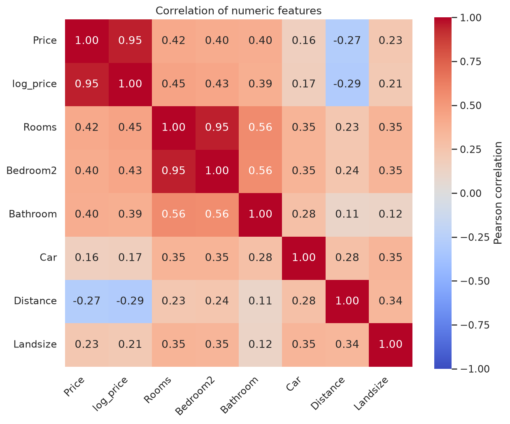
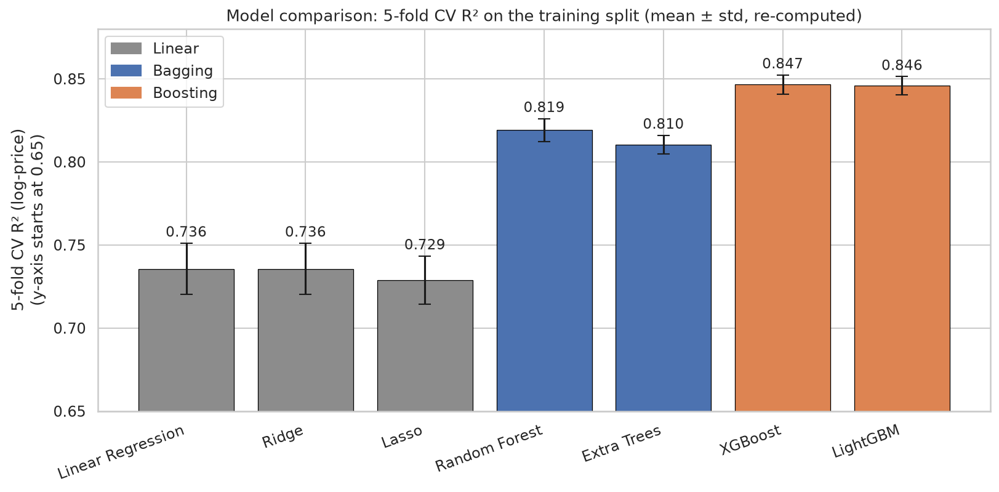
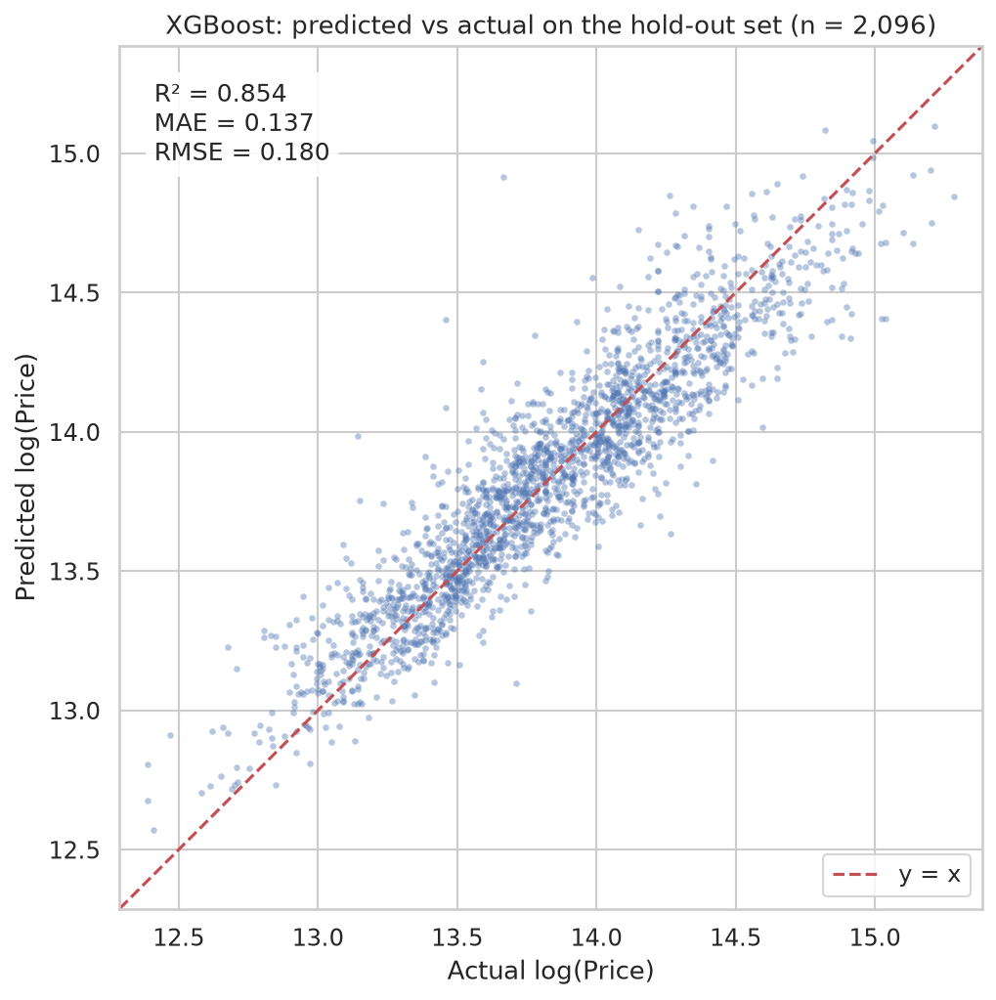
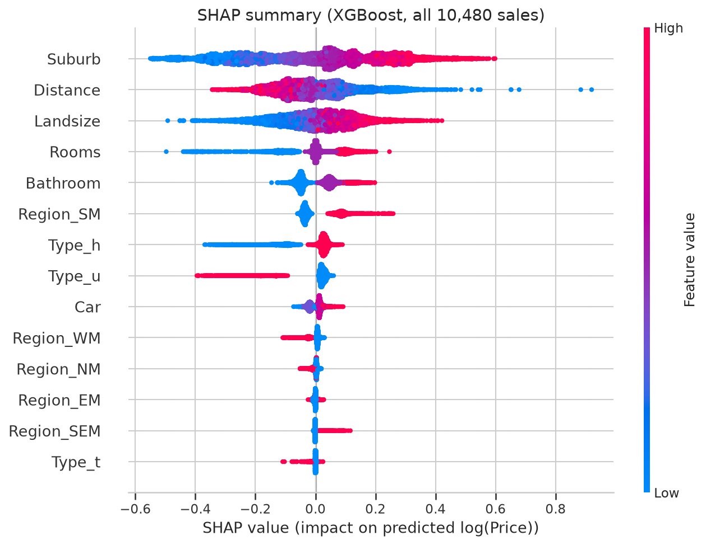
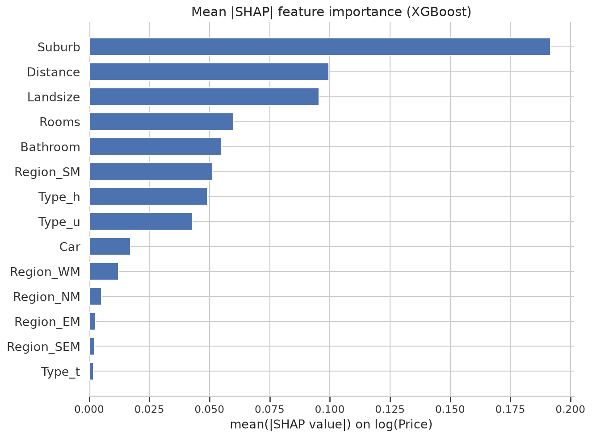

# Melbourne Housing Price Analysis

End-to-end analysis of the Melbourne Housing Snapshot dataset (Kaggle): data cleaning, SQL analysis, exploratory analysis, visualization and regression modeling.
The regression part is the basis of the paper **"The Impact of Suburb-Level Encoding on Melbourne Housing Price Prediction"** (SCI-2026, accepted / under publication; see `Realestate (3).pdf`).

<p align="center">
  
</p>

## Key findings

- **Suburb information improves Random Forest hold-out R².** Test R² rises from 0.815 to 0.835 in the paper (0.809 → 0.830 re-computed, [Fig. 6](#6-suburb-ablation-and-shuffled-suburb-control)).
- **The shuffled-suburb control removes the gain.** With suburb labels randomly permuted, test R² drops to 0.810 in the paper (0.806 re-computed), slightly below the no-suburb model, so the gain comes from real locality signal and not from the encoding itself.
- **Boosting beats bagging, and bagging beats linear models.** XGBoost and LightGBM reach 5-fold CV R² 0.843 in the paper (0.847 / 0.846 re-computed), against 0.808–0.819 for Random Forest / Extra Trees and 0.729–0.736 for the linear models ([Fig. 5](#5-model-comparison-5-fold-cv)).
- **Suburb, Distance, Landsize and Rooms are the top SHAP features** of the XGBoost model, in that order ([Fig. 8](#8-shap-feature-attribution-xgboost)).

## Notebooks

| # | Notebook | Content |
|---|---|---|
| 1 | Business Understanding and Analytic Approach | Problem statement and plan |
| 2 | Data Collection, Understanding, Preparation | Cleaning (13,580 -> 10,480 rows), encoding, outlier removal |
| 3 | Data Analysis with SQL | SQL queries on `melb_real_estate.db` |
| 4 | Data Analysis with Python | Box plots, average price by region / property type, correlation analysis |
| 5 | Data Visualization | Charts of price vs. property features |
| 6 | Regression Analysis | 7 models, suburb ablation, shuffled-suburb control, SHAP |

## Method (notebook 6)

- Target: `log(Price)`; 80/20 train/test split, 5-fold CV on the training set (`random_state=42`).
- Suburb handled with target encoding (smoothing=10, min_samples_leaf=20), fitted inside each fold to avoid leakage.
- Models: Linear, Ridge, Lasso, Random Forest, Extra Trees, XGBoost, LightGBM.
- Locality ablation with Random Forest: without suburb / with suburb / shuffled suburb.

## Results reported in the paper (log-price scale)

| Model | 5-fold CV R^2 |
|---|---|
| Linear / Ridge | 0.736 |
| Lasso | 0.729 |
| Random Forest | 0.819 |
| Extra Trees | 0.808 |
| XGBoost / LightGBM | 0.843 |

| Random Forest setting | Train R^2 | Test R^2 |
|---|---|---|
| Without Suburb | 0.847 | 0.815 |
| With Suburb | 0.871 | 0.835 |
| Shuffled Suburb | 0.851 | 0.810 |

SHAP on the XGBoost model ranks Suburb, Distance, Landsize and Rooms as the most influential features.

> Reproducibility note: re-running the code in this repository gives values within about 0.006 R^2 of the table above (for example XGBoost CV R^2 0.847, Random Forest test R^2 0.809 without and 0.830 with suburb). The conclusions are unchanged. The shuffle test in notebook 6 uses `np.random.permutation` without a fixed seed, so it varies slightly between runs; `make_figures.py` uses a fixed seed (42).

## Results (re-computed figures)

The figures below are generated by [`make_figures.py`](make_figures.py) from `melb_data_cleaned.csv` with the same settings as notebook 6 and fixed seeds.
**Numbers shown in the figures are re-computed values, not the paper's**; they differ from the tables above by up to about 0.006 R^2. Every number is also written to [`figures/figures_data.json`](figures/figures_data.json).

### 1. Price distribution



Raw sale prices are strongly right-skewed, while `log(Price)`, the model target, is close to symmetric.

### 2. Median price by region



Southern Metropolitan has the highest median sale price (about 1.43M AUD), well above the other four regions (0.83M–1.03M AUD).

### 3. log(Price) vs distance to the CBD



House prices fall with distance from the CBD (r = -0.37 for houses, -0.18 for townhouses), unit prices show almost no distance trend (r = 0.03), and units sell for less than houses at most distances.

### 4. Correlation of numeric features



Rooms, Bedroom2 and Bathroom correlate positively with `log_price` (0.39–0.45), Distance correlates negatively (-0.29), and Rooms and Bedroom2 are almost collinear (0.95).

### 5. Model comparison (5-fold CV)



Mean ± std of 5-fold CV R² on the training split for the 7 models: XGBoost and LightGBM score highest, ahead of Random Forest / Extra Trees and the linear models (Random Forest uses the tuned configuration from notebook 6).

### 6. Suburb ablation and shuffled-suburb control


Random Forest hold-out metrics without suburb, with target-encoded suburb, and with shuffled suburb labels: adding suburb raises test R² and lowers MAE/RMSE, and shuffling the labels removes that gain.

### 7. Predicted vs actual (best model)



XGBoost predictions on the 20% hold-out set lie close to the y = x line (re-computed test R² 0.854), with the highest and lowest prices pulled slightly toward the mean.

### 8. SHAP feature attribution (XGBoost)

| Beeswarm | Mean \|SHAP\| |
|---|---|
|  |  |

Suburb (target-encoded) has by far the largest mean |SHAP| value, followed by Distance, Landsize and Rooms; higher suburb encodings and larger land sizes push predictions up, while larger distances push them down.

## How to reproduce

Requires [uv](https://docs.astral.sh/uv/). Dependencies are declared in `pyproject.toml` and pinned in `uv.lock`.

```bash
uv sync                               # create .venv with the locked dependencies (Python 3.12)
uv run python make_figures.py         # regenerate figures/*.png and figures/figures_data.json
uv run --with jupyter jupyter notebook   # optional: open the notebooks
```

Run the notebooks in order; notebook 6 and `make_figures.py` read `melb_data_cleaned.csv`.

## Files

- `melb_data.csv`: raw data (13,580 rows)
- `melb_data_cleaned.csv`: cleaned data (10,480 rows)
- `melb_real_estate.db`: SQLite copy of the cleaned data
- `make_figures.py`: regenerates every figure in `figures/`
- `figures/figures_data.json`: the numbers behind each figure
